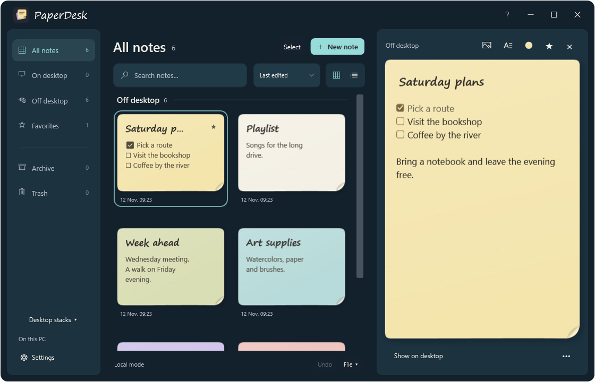
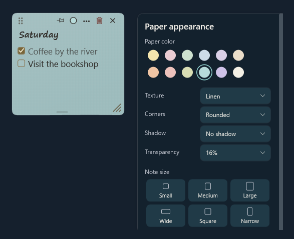

  

  <a href="https://github.com/Zkvr/PaperDesk/releases/tag/v0.7.0-rc"><strong>Download v0.7.0-rc</strong></a>
  &nbsp;·&nbsp; <a href="#themes-and-paper">What's new</a>
  &nbsp;·&nbsp; <a href="#start-writing">Quick start</a>
  &nbsp;·&nbsp; <a href="docs/USER-GUIDE.ru.md">Инструкция на русском</a>

Keep a checklist beside your work, a stack for each project, and a blank sheet for your next thought. PaperDesk puts sticky notes on your Windows desktop. Everything stays on your computer, and you can start writing offline without an account.

## Themes and paper

Switch between Graphite, Ocean, and Clay in **Settings → Appearance**. The theme applies immediately to the manager.

Click the color dot to choose from 12 paper colors, three textures, corner and shadow styles, and six desktop sizes. Adjust paper transparency while keeping the ink solid.

## A desk you can arrange

Give each project its own stack. Drag a note or a whole stack by its upper edge onto another note to combine them. Pull the lower edge to peel off one sheet, then leave it on the desktop or drop it onto another stack.

Turn on **Snap sheets to nearby edges** in **Settings → Gestures and animation** to line up adjacent notes as you drag them. Gestures and snapping work with animations switched off.

## Write and organize

- Edit checklists, tables, and spoilers directly on the paper. Paste or drag in an image and choose inline, wrap, or overlay placement.
- Bring notes forward with a shortcut, or use **Ctrl+F** and **Enter** to find and open a note in the manager. Duplicate a note with its attachments or move several notes into a stack.
- Favorites stay at the top of each section. Press **F1** in the manager for shortcuts and stack gestures.
- Export notes, images, and desktop stacks to a JSON backup you can move to another PC.

### Crumple a finished note

  

## Start writing

The Windows x64 release candidate includes .NET and follows your Windows display language for English or Russian. The installer requires Windows 10 build 19041 or newer. Download either package and its `SHA256SUMS.txt` from the same release. [PaperDesk v0.7.0-rc](https://github.com/Zkvr/PaperDesk/releases/tag/v0.7.0-rc).

| Choose | Open |
| --- | --- |
| **Installer** | Run `PaperDesk-Setup-win-x64.exe` to add PaperDesk to Windows. |
| **Portable ZIP** | Extract `PaperDesk-Portable-win-x64.zip` to a writable folder and open `PaperDesk.exe`. |

Use **Ctrl+Alt+N** for a new desktop note and **Ctrl+Alt+Space** to bring your notes forward. In the manager, **Ctrl+V** pastes an image into the selected note. Use **File → Export a backup…** to save your notes and images as a JSON file you can move to another PC.

[Install, update and restore your notes](docs/USER-GUIDE.md) · [Инструкция на русском](docs/USER-GUIDE.ru.md) · [Changelog](CHANGELOG.md)

## Build from source

On Windows, install the .NET SDK specified in `global.json` and run `dotnet build PaperDesk.sln -c Release`. To run the built app, use `dotnet run --project PaperDesk.Desktop -c Release`.

The Windows editor uses Tiptap and ProseMirror inside Microsoft Edge WebView2. The editor bundle ships with the application and works offline. On PCs without the WebView2 Runtime, PaperDesk opens the built-in Windows editor. To rebuild the editor bundle after changing it, run `npm ci` and `npm run build` in `PaperDesk.Desktop/WebEditor`.

[Packaging and release process](docs/RELEASING.md)

