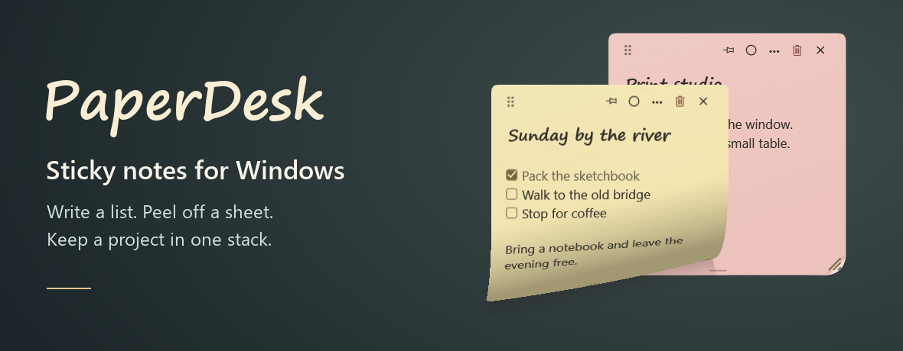
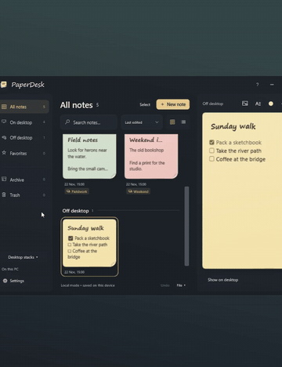
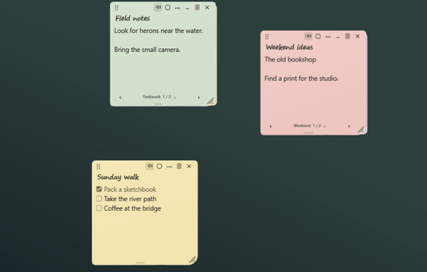
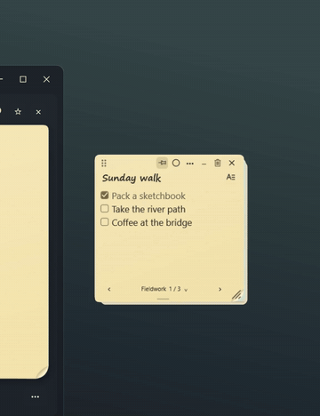
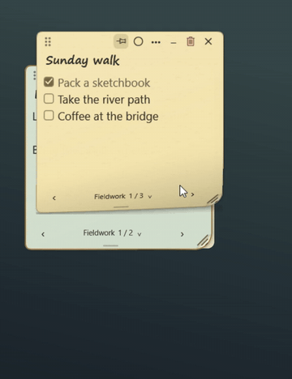
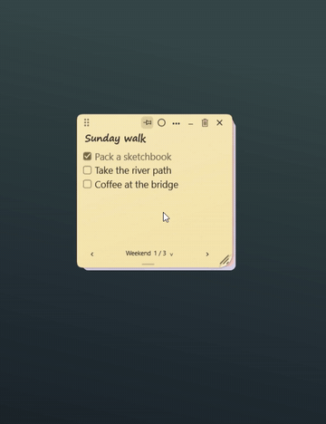
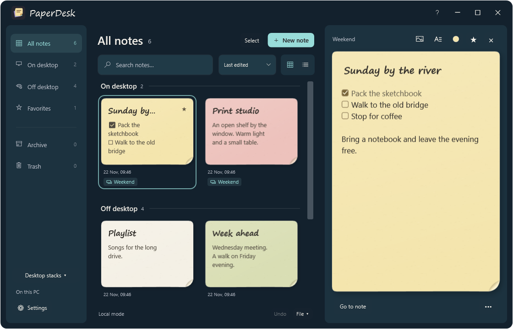
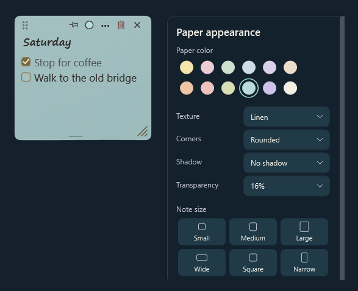

  

  <a href="https://github.com/Zkvr/PaperDesk/releases/tag/v0.9.1-beta"><strong>Download the Windows preview</strong></a>
  &nbsp;·&nbsp; <a href="https://github.com/Zkvr/PaperDesk/releases/tag/v0.9.1-beta#whats-new">What's new</a>
  &nbsp;·&nbsp; <a href="#start-writing">Quick start</a>

PaperDesk puts checklists, notes, and project stacks on your Windows desktop. It works offline without an account.

## From the manager to the desktop

Pick up a note card in the manager, drag it onto an open spot on the Windows desktop, and let go.

## Desktop notes and stacks

### Put a sheet on top

Use the upper grip to move a note. Drop it over another note or stack. The incoming sheet becomes **1 of 3** here, with the previous top sheet directly below.

### Peel one sheet free

Grab the lower edge. A short sideways pull bends the corner while the top holds. Pull back toward the top edge to free the sheet sooner.

### Move it to another stack

Carry the peeled sheet to a second stack. It becomes the first sheet there too.

### Discard the top sheet

Click the trash icon. The upper note crumples, revealing the note just beneath it.

## Themes and paper

Switch between Graphite, Ocean, and Clay in **Settings → Appearance**. The theme applies immediately to the manager.

Click the color dot on a sheet to choose its color, texture, corners, shadow, transparency, and size.

  

## Write and organize

- Edit checklists, tables, and spoilers on the paper. Paste or drag in an image and choose inline, wrap, or overlay placement.
- Find a note with **Ctrl+F** and open it with **Enter**. Keep favorites at the top and move several notes into a stack together.
- Export notes, images, and desktop stacks to a JSON backup you can restore on another PC.

## Start writing

PaperDesk runs on Windows 10 build 19041 or newer and Windows 11 (x64). Both packages include .NET. The app follows the Windows display language for English and Russian.

| Download | Open |
| --- | --- |
| [Installer](https://github.com/Zkvr/PaperDesk/releases/download/v0.9.1-beta/PaperDesk-Setup-win-x64.exe) | Run setup to add PaperDesk to Windows. |
| [Portable ZIP](https://github.com/Zkvr/PaperDesk/releases/download/v0.9.1-beta/PaperDesk-Portable-win-x64.zip) | Extract to a writable folder and open `PaperDesk.exe`. |

Use **Ctrl+Alt+N** for a new desktop note and **Ctrl+Alt+Space** to bring your notes forward. Press **F1** in the manager for shortcuts and stack gestures.

[Installation and backups](docs/USER-GUIDE.md) · [SHA-256 checksums](https://github.com/Zkvr/PaperDesk/releases/download/v0.9.1-beta/SHA256SUMS.txt) · [Changelog](CHANGELOG.md)

## Build from source

On Windows, install the .NET SDK specified in `global.json` and run `dotnet build PaperDesk.sln -c Release`. To run the built app, use `dotnet run --project PaperDesk.Desktop -c Release`.

The Windows editor uses Tiptap and ProseMirror inside Microsoft Edge WebView2. The editor bundle ships with the application and works offline. On PCs without the WebView2 Runtime, PaperDesk opens the built-in Windows editor. To rebuild the editor bundle after changing it, run `npm ci` and `npm run build` in `PaperDesk.Desktop/WebEditor`.

[Packaging and release process](docs/RELEASING.md)

