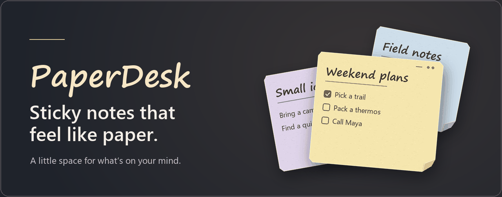
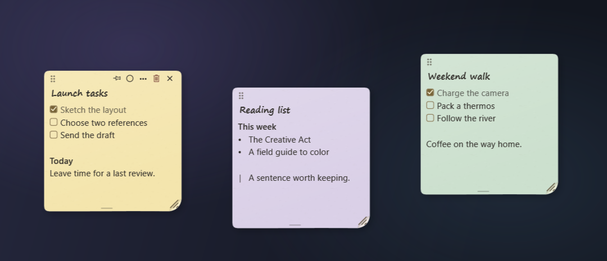
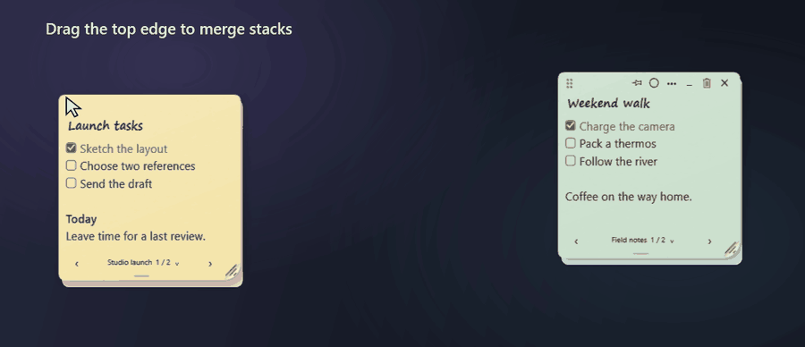
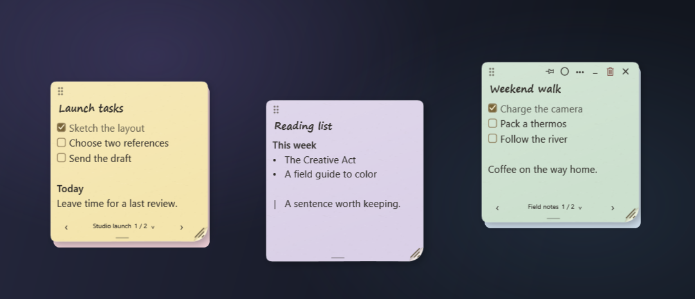
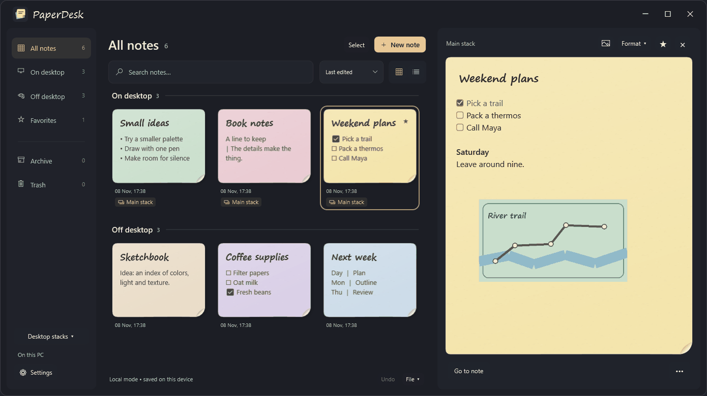
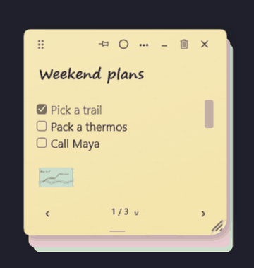

  

  <a href="https://github.com/Zkvr/PaperDesk/releases"><strong>Windows builds</strong></a>
  &nbsp;·&nbsp; <a href="#a-desk-you-can-arrange">See how it works</a>
  &nbsp;·&nbsp; <a href="#start-writing">Quick start</a>

Keep a checklist beside your work, a stack for each project, and a blank sheet for your next thought. PaperDesk puts sticky notes on your Windows desktop. Everything stays on your computer, and you can start writing offline without an account.

## A desk you can arrange

Give each project its own stack. Drag a note or a whole stack by its upper edge onto another note to combine them. Pull the lower edge to peel off one sheet, then leave it on the desktop or drop it onto another stack.

## Write and organize

- Edit checklists, tables, and spoilers directly on the paper. Paste or drag in an image and choose inline, wrap, or overlay placement.
- Bring notes forward with a shortcut, or find them with search and filters. Archive or trash several sheets at once.
- Export notes, images, and desktop stacks to a JSON backup you can move to another PC.

### Crumple a finished note

  

## Start writing

The preview runs on Windows 10 version 2004 or newer and Windows 11 (x64). It follows your Windows display language for English or Russian. Both packages include .NET.

| Choose | Open |
| --- | --- |
| **Installer** | Run `PaperDesk-Setup-win-x64.exe` to add PaperDesk to Windows. |
| **Portable ZIP** | Extract `PaperDesk-Portable-win-x64.zip` to a writable folder and open `PaperDesk.exe`. |

Use **Ctrl+Alt+N** for a new desktop note and **Ctrl+Alt+Space** to bring your notes forward. In the manager, **Ctrl+V** pastes an image into the selected note. Use **File → Export / backup** to save your notes and images as a JSON file you can move to another PC.

## Build from source

On Windows, install the .NET SDK specified in `global.json` and run `dotnet build PaperDesk.sln -c Release`. To run the built app, use `dotnet run --project PaperDesk.Desktop -c Release`.

The Windows editor uses Tiptap and ProseMirror inside Microsoft Edge WebView2. The editor bundle ships with the application and works offline. On PCs without the WebView2 Runtime, PaperDesk opens the built-in Windows editor. To rebuild the editor bundle after changing it, run `npm ci` and `npm run build` in `PaperDesk.Desktop/WebEditor`.

